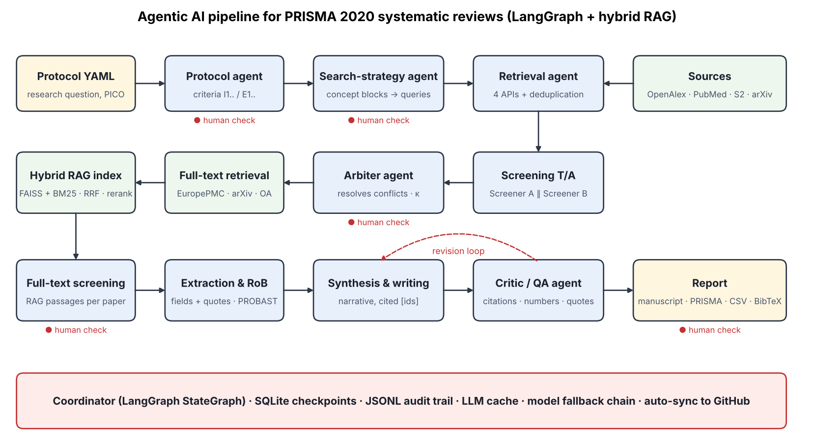

# Agentic AI Pipeline for Rigorous, Transparent and Reproducible Systematic Reviews

An autonomous **multi-agent system** (LangGraph + hybrid RAG) that conducts an end-to-end systematic literature
review following **PRISMA 2020**: protocol → search strategy → multi-database retrieval → deduplication →
dual title/abstract screening with arbitration → full-text retrieval and RAG indexing → full-text eligibility →
data extraction and risk-of-bias appraisal → narrative synthesis → critic/QA loop → manuscript, PRISMA flow
diagram, evidence tables, BibTeX and meta-analysis-ready data. Humans validate the critical decisions.

**Demonstration topic:** *Machine learning for predicting readmission or mortality in heart failure.*
The system is generic: a new review only requires a new YAML protocol file.



---

## Contents
1. [Key features](#1-key-features)
2. [Architecture and agents](#2-architecture-and-agents)
3. [Repository structure](#3-repository-structure)
4. [Installation](#4-installation)
5. [Configuration](#5-configuration)
6. [Execution](#6-execution)
7. [Outputs](#7-outputs)
8. [Evaluation](#8-evaluation)
9. [Demo interface](#9-demo-interface)
10. [Development steps followed](#10-development-steps-followed)
11. [Limitations](#11-limitations)
12. [Team and individual contributions](#12-team-and-individual-contributions)
13. [References](#13-references)

---

## 1. Key features

| Project objective | How it is implemented |
|---|---|
| Modular multi-agent architecture | Specialised agents (the 7 roles of the specification, with screening split into A, B and an arbiter) orchestrated by a LangGraph `StateGraph` coordinator (`sr_agent/graph.py`) |
| Advanced RAG | Full texts chunked and indexed with **dense (FAISS, `bge-small-en-v1.5`) + sparse (BM25)** retrieval, **reciprocal rank fusion**, **cross-encoder re-ranking** and **sentence-level context compression** (`sr_agent/rag/index.py`) |
| Full PRISMA workflow | Protocol, search, deduplication, dual screening, arbitration, full-text eligibility, extraction, PROBAST risk of bias, synthesis, flow diagram, report |
| Transparency | Every decision stores the criteria failed and a rationale; extracted values carry **verbatim quotes automatically verified against the source text**; complete JSONL audit trail |
| Reproducibility | Deterministic query assembly, temperature 0, LLM response cache, SQLite graph checkpoints, versioned outputs in `runs/`, model names logged |
| Human-in-the-loop | 5 validation points (protocol, search strategy, T/A screening, full-text screening, final report); free-text feedback triggers regeneration; `include <id>` / `exclude <id>` overrides are logged |
| Generality | Any topic: edit `configs/*.yaml`; the *New topic* tab of the demo generates a protocol and search strategy live |
| Robustness | Resumable after any interruption (each step is skipped if its output exists, item-level JSONL); automatic **model fallback chain** when a daily LLM quota is reached; periodic auto-push to GitHub |

## 2. Architecture and agents

| Agent | File | Role | Model (default) |
|---|---|---|---|
| Coordinator / Planner | `graph.py` | Stage ordering, state, routing, human checkpoints, resumption | — |
| Protocol | `agents/protocol_agent.py` | Turns the YAML draft into operational, numbered criteria (I1.., E1..) | strong |
| Search strategy | `agents/search_strategy_agent.py` | Concept blocks (synonyms + MeSH); queries assembled deterministically for each database | strong |
| Retrieval | `tools/sources.py`, `tools/dedup.py`, `tools/fulltext.py` | OpenAlex, PubMed, Semantic Scholar, arXiv; DOI/title/fuzzy deduplication; open-access full texts | — |
| Screening A / B | `agents/screening_agent.py` | Independent title/abstract screening, *sensitive* (A) vs *specific* (B) instructions, batches of 6 | fast / strong |
| Arbiter | `agents/screening_agent.py` | Resolves A/B disagreements and uncertain cases | strong |
| Full-text screening | `agents/screening_agent.py` | Eligibility on RAG passages of each paper | strong |
| Extraction & appraisal | `agents/extraction_agent.py` | 15 structured fields + verbatim evidence + PROBAST (4 domains) | strong |
| Synthesis & writing | `agents/synthesis_agent.py` | Narrative synthesis grounded only in the evidence table, every claim cited | strong |
| Critic / QA | `agents/critic_agent.py` | Deterministic checks (invalid/uncited citations, numbers not in the table, unverifiable quotes) + LLM review; triggers up to 2 revisions | strong |

**Design choices**
- *LLM proposes, code disposes*: the LLM proposes concept blocks; Boolean queries are built by code → reproducible and auditable.
- Large data live on disk (`RunStore`); the graph state only carries control information → cheap checkpoints.
- Structured outputs are validated by **Pydantic**; invalid JSON is automatically re-requested with the validation error.
- The Methods section of the manuscript is generated **deterministically** from what the pipeline actually did.

## 3. Repository structure
```
configs/protocol_demo.yaml   review protocol (the only file to change for a new topic)
sr_agent/
  graph.py                   LangGraph coordinator, human checkpoints, resumption
  llm.py                     rate limiting, retries, JSON validation, model fallback chain
  schemas.py                 Pydantic schemas exchanged between agents
  agents/                    protocol, search strategy, screening/arbiter, extraction, synthesis, critic
  tools/                     database connectors, deduplication, full-text retrieval, report builder
  rag/index.py               hybrid RAG index
  evaluation.py              evaluation metrics and blinded human labelling
  demo_app.py                Gradio demo (replay mode + live new topic)
  utils/checkpoint.py        persistence, audit trail, PRISMA counters
notebooks/main_kaggle.ipynb  end-to-end execution notebook (Kaggle)
run.py                       command-line execution (local)
runs/demo_hf_ml/             all outputs of the demonstration review (see §7)
docs/                        architecture diagram, video script
```

## 4. Installation

### Option A — Kaggle (used for the demonstration)
1. Create a Kaggle notebook, **File → Import Notebook →** `notebooks/main_kaggle.ipynb`.
2. *Settings*: **Internet ON** (requires a phone-verified account); *Accelerator*: GPU T4 optional (speeds up embeddings).
3. *Add-ons → Secrets* (tick **attach**):
   - `LLM_API_KEY` — Groq API key (free at console.groq.com),
   - `GITHUB_TOKEN` — fine-grained token with *Contents: read & write* on this repository,
   - `CEREBRAS_API_KEY` — optional, free at cloud.cerebras.ai (larger daily token quota),
   - `S2_API_KEY` — optional Semantic Scholar key.
4. Edit cell 1 (GitHub user, e-mail) and run cells 1–6. Cell 6 tests the LLMs and the four databases.

### Option B — Local
```bash
git clone https://github.com/mouadili-merouane/agentic-systematic-review.git
cd agentic-systematic-review
python -m venv .venv && source .venv/bin/activate
pip install -r requirements.txt
export GROQ_API_KEY=...   CONTACT_EMAIL=you@example.com
python run.py --protocol configs/protocol_demo.yaml
```
Python ≥ 3.10. Other providers: `--provider google_genai` or `openai` with the matching key and model names.

## 5. Configuration
`configs/protocol_demo.yaml`:

| Key | Meaning |
|---|---|
| `review_id` | output folder name in `runs/` |
| `title`, `research_question`, `pico` | review question (PICO) |
| `study_designs`, `inclusion`, `exclusion` | draft criteria, operationalised by the Protocol agent |
| `years`, `languages` | limits |
| `sources` | maximum records retrieved per database |
| `human_in_the_loop` | enable/disable validation pauses |
| `max_extraction` | number of included studies sent to extraction/synthesis (reproducible sample); `null` = all |
| `fulltext_required` | `false`: papers without open-access full text are assessed on the abstract (flagged `abstract_only`); `true`: counted as *not retrieved* |

LLM roles (notebook cell 1 or `run.py --fast/--strong`) are **chains** that may mix providers
(`cerebras:gpt-oss-120b`, then Groq `openai/gpt-oss-120b`, `openai/gpt-oss-20b`): when a model reaches its daily quota
(e.g. Groq free tier: 200k tokens/day per model) the next one is used automatically and the switch is logged; if all are
saturated the pipeline waits for the quota to refill. Keys: `LLM_API_KEY` (Groq) and optional `CEREBRAS_API_KEY`.

## 6. Execution
- **Notebook**: run the *PIPELINE EXECUTION* cell. The coordinator resumes from where it stopped.
- **Human checkpoints**: answer `ok`; or a correction in natural language (protocol, strategy, final report → the agent regenerates); or `include <id>` / `exclude <id>` (screening).
- **Interruptions** (session timeout, quota): just re-run — completed steps and already-processed papers are skipped with no new LLM call.
- **Evaluation**: section *LOT 4* of the notebook, or `python run.py --evaluate`.
- **Demo**: last notebook cell, or `python run.py --demo`.

## 7. Outputs
All in `runs/<review_id>/`:

| File | Content |
|---|---|
| `01_protocol.json`, `02_search_strategy.json` | protocol and queries actually run |
| `03_raw_<source>.json`, `04_records.json`, `04_dedup_log.json` | raw records, deduplicated records, merge log |
| `05_ta_A.jsonl`, `05_ta_B.jsonl`, `05_ta_final.jsonl`, `05_ta_summary.json` | screener decisions with rationale, arbitration, κ |
| `06_fulltext.jsonl`, `fulltext/`, `rag/` | full-text retrieval status, texts, RAG index |
| `07_ft.jsonl` | full-text eligibility decisions |
| `08_extraction.jsonl` | extracted data, evidence quotes, PROBAST |
| `09_synthesis.json`, `10_critique*.json` | synthesis and QA passes |
| `report/manuscript.md` / `.docx` | review manuscript draft |
| `report/prisma_flow.png` | PRISMA 2020 flow diagram |
| `report/evidence_table.csv`, `meta_analysis_ready.csv`, `references.bib` | tables and references |
| `prisma_counts.json`, `audit_log.jsonl`, `approvals.json` | PRISMA counters, full audit trail, human validations |
| `eval/` | human labels and evaluation report |

## 8. Evaluation
Metrics required by the project, computed by `sr_agent/evaluation.py`:

| Dimension | Metric |
|---|---|
| **Accuracy** | Screening vs a **blinded human reviewer** on a random stratified sample (accuracy, sensitivity, specificity, precision, κ); extraction fields checked against the papers |
| **Inter-agent consistency** | Cohen's κ and raw agreement between screeners A and B; share of arbitrated decisions; % of evidence quotes found verbatim in the source; critic revision rounds |
| **Completeness** | Pipeline stages completed, full-text retrieval rate, field fill rate per extraction field, PRISMA 2020 key items present in the manuscript, decisions with rationale |
| **Time savings** | Active pipeline time (from audit timestamps) vs a manual estimate for dual screening and extraction; benchmark: 67.3 weeks mean duration of a published systematic review (Borah et al., 2017) |

**Results of the demonstration review:** see [`runs/demo_hf_ml/eval/evaluation_report.md`](runs/demo_hf_ml/eval/evaluation_report.md).
Title/abstract screening: 272 records, κ(A,B) = 0.837, raw agreement 0.923, 50 disagreements arbitrated.

## 9. Demo interface
`sr_agent/demo_app.py` (Gradio), 7 tabs: architecture and replay of the audit trail · protocol and queries ·
screening with each agent's reasoning · extraction with verified quotes and PROBAST · PRISMA diagram, metrics and
critic passes · generated manuscript · **new topic (live)**. Replay mode makes no LLM call.
The 3-minute video script is in [`docs/video_script.md`](docs/video_script.md).

## 10. Development steps followed
| Step | Work | Problems met and solutions |
|---|---|---|
| 0. Analysis | Requirements and deliverables analysis; demo topic chosen; Kaggle + Groq + GitHub selected | Kaggle sessions are time-limited → GitHub used as persistent store |
| 1. Search | Protocol and search-strategy agents, 4 database connectors, deduplication, LangGraph coordinator with human checkpoints and SQLite checkpointer | Groq retired the Llama 3.x models (Aug 2026) → `gpt-oss-20b/120b`; ambiguous term "HF" kept and reported as a limitation |
| 2. Screening + RAG | Dual screening in batches, arbiter, κ, full-text retrieval (Europe PMC, arXiv, OA PDFs, Unpaywall), hybrid RAG index, full-text eligibility | Free-tier rate limits → batching, throttling, retries, LLM cache; many paywalled papers → `abstract_only` flag |
| 3. Synthesis | Extraction with verified quotes, PROBAST, synthesis, critic loop, report builder (Markdown/DOCX, PRISMA diagram, CSV, BibTeX) | Daily quota reached during arbitration → automatic model fallback chain, quota-wait mode, background execution, second provider (Cerebras), extraction limited to a reproducible sample |
| 4. Evaluation & demo | Blinded human labelling, metrics, Gradio demo, documentation, video | — |

## 11. Limitations
- Only open-access full texts are retrievable; others are assessed on abstracts (flagged and counted).
- **Demonstration scope:** to stay within the free LLM quota, data extraction, risk-of-bias appraisal and synthesis were run on a reproducible random sample of 10 included studies (`max_extraction: 10`, seed 42, priority to open-access full texts). Setting `max_extraction: null` processes all included studies.
- Retrieval is capped per database for the demonstration (top-N by relevance), so recall is not exhaustive.
- LLM decisions can be wrong; human validation points and the critic agent mitigate but do not remove this risk. The manuscript is a **draft that requires expert verification**.
- No quantitative pooling (narrative synthesis); data are exported for meta-analysis.
- Free-tier LLMs (open-weight models via Groq) were used; results may differ with other models.

## 12. Team and individual contributions
| Member | Contribution |
|---|---|
| *Name 1* | *e.g. coordinator, LangGraph orchestration, checkpoints* |
| *Name 2* | *…* |
| *Name 3* | *…* |
| *Name 4* | *…* |
| *Name 5* | *…* |

## 13. References
- Page MJ, et al. The PRISMA 2020 statement: an updated guideline for reporting systematic reviews. *BMJ* 2021;372:n71.
- Wolff RF, et al. PROBAST: a tool to assess the risk of bias and applicability of prediction model studies. *Ann Intern Med* 2019;170:51–58.
- Borah R, et al. Analysis of the time and workers needed to conduct systematic reviews of medical interventions using data from the PROSPERO registry. *BMJ Open* 2017;7:e012545.
- Landis JR, Koch GG. The measurement of observer agreement for categorical data. *Biometrics* 1977;33:159–174.
- LangGraph documentation — https://langchain-ai.github.io/langgraph/
